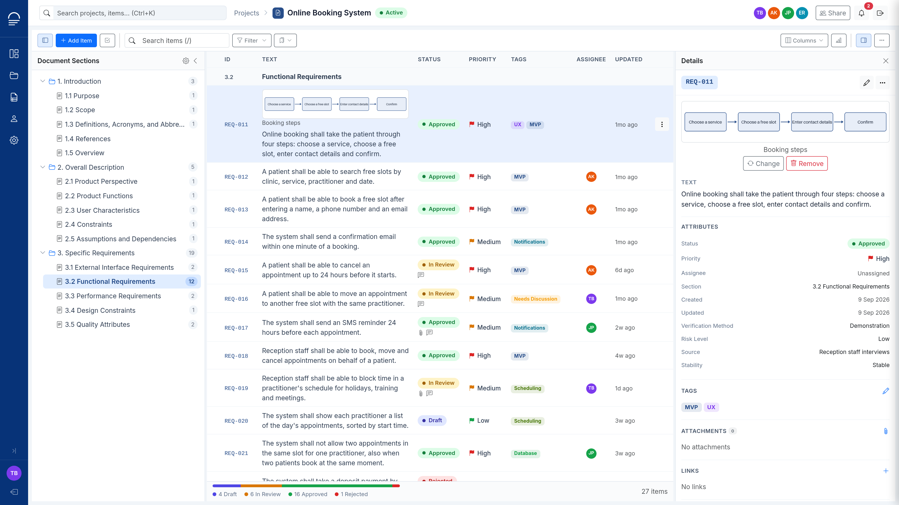
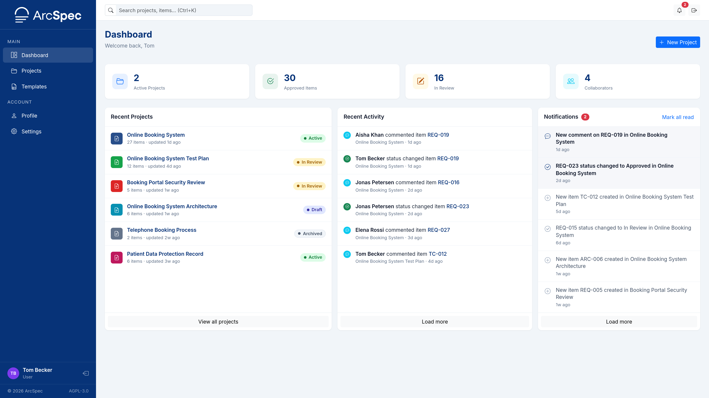
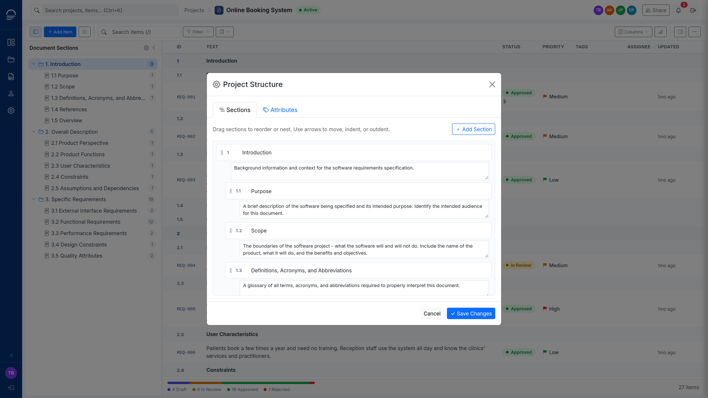
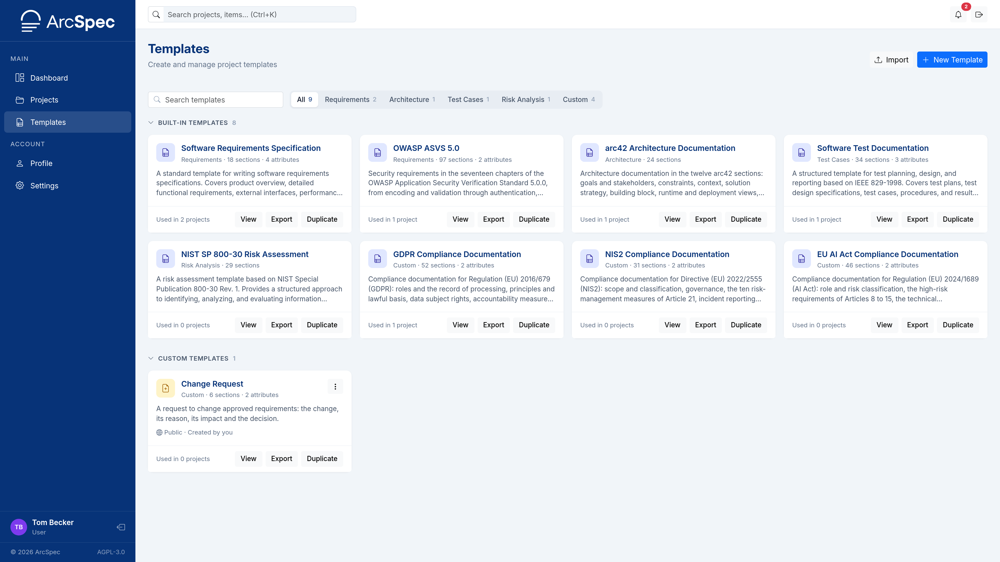
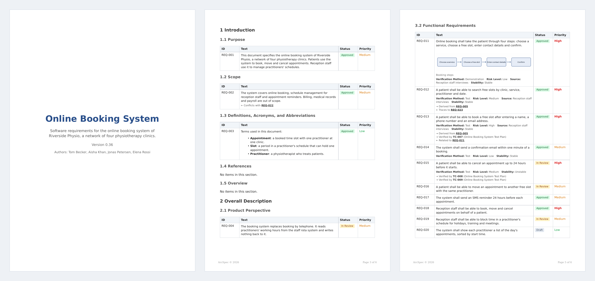

  <picture>
    <source media="(prefers-color-scheme: dark)" srcset="docs/images/logo-white.png">
    
  </picture>
 <br>  

# Self-hosted tool to create and manage architecture and requirement specifications

User manual: [docs/manual/README.md](docs/manual/README.md)



## Install

```
cp .env.example .env
docker compose up -d --build
docker compose exec web python manage.py migrate
```

## Environment variables

| Variable | Value | Required |
|---|---|---|
| `DJANGO_SETTINGS_MODULE` | `config.settings.production`. Default: `config.settings.development`. | Yes |
| `SECRET_KEY` | Random string, at least 50 characters. | Yes |
| `ALLOWED_HOSTS` | Host names without scheme, comma-separated, `localhost` included, e.g. `arcspec.example.com,localhost`. | Yes |
| `SITE_URL` | Public address with scheme, no trailing slash, e.g. `https://arcspec.example.com`. | Yes |
| `POSTGRES_DB` | Database name. | Yes |
| `POSTGRES_USER` | Database user. | Yes |
| `POSTGRES_PASSWORD` | Database password. | Yes |
| `ENTRA_TENANT_ID` | Microsoft Entra ID tenant. Empty disables Microsoft sign-in. | No |
| `ENTRA_CLIENT_ID` | Microsoft Entra ID application ID. | No |
| `ENTRA_CLIENT_SECRET` | Microsoft Entra ID client secret. | No |
| `AUTH_CALLBACK_PREFIX` | Any URL-safe string. Redirect URI to register in Entra: `<SITE_URL>/auth/callback/<AUTH_CALLBACK_PREFIX>/microsoft/login/callback/` | Yes |
| `TURNSTILE_SITE_KEY` | Cloudflare Turnstile site key. Empty disables Turnstile in the Captcha setting. | No |
| `TURNSTILE_SECRET_KEY` | Cloudflare Turnstile secret key. | No |
| `HCAPTCHA_SITE_KEY` | hCaptcha site key. Empty disables hCaptcha in the Captcha setting. | No |
| `HCAPTCHA_SECRET_KEY` | hCaptcha secret key. | No |
| `EMAIL_HOST` | SMTP server host name without scheme, e.g. `smtp.example.com`. | Yes |
| `EMAIL_PORT` | SMTP port, default 587. | No |
| `EMAIL_HOST_USER` | SMTP user. | Yes |
| `EMAIL_HOST_PASSWORD` | SMTP password. | Yes |
| `DEFAULT_FROM_EMAIL` | Sender address. | No |

## First administrator

```
docker compose exec web python manage.py create_admin admin@example.com
```

Creates the first administrator and prints a generated password.

## Roles

System roles:

| Role | Can |
|---|---|
| Viewer | Open projects they are a member of. |
| User | Viewer, plus create projects and templates. |
| Administrator | User, plus admin of every project, the Admin Panel, any custom template. |

Project roles:

| Role | Can |
|---|---|
| Viewer | Read, export, comment. |
| Editor | Viewer, plus edit sections, items, tags, attachments, links, attributes. |
| Admin | Editor, plus edit, archive and delete the project, manage members, restore versions. |

## Document templates

A project is created from a document template. Users create their own document templates from scratch, by duplicating another and modifying it, or by importing a template file.

The built-in templates are included:

| Template | Type | Sections |
|---|---|---|
| Software Requirements Specification | Requirements | 18 |
| OWASP ASVS 5.0 | Requirements | 97 |
| arc42 Architecture Documentation | Architecture | 24 |
| Software Test Documentation | Test Cases | 34 |
| NIST SP 800-30 Risk Assessment | Risk Analysis | 29 |
| GDPR Compliance Documentation | Custom | 52 |
| NIS2 Compliance Documentation | Custom | 31 |
| EU AI Act Compliance Documentation | Custom | 46 |

### Template file

On the Templates page, Export downloads a template as a JSON file and Import creates a private template from one. The file size limit is 1 MB.

```
{
  "format": "arcspec-template",
  "version": 1,
  "name": "<name>",
  "description": "<text>",
  "doc_type": "requirements | architecture | testcases | risk | custom",
  "sections": [
    {"title": "<title>", "description": "<text>", "children": [<sections>]}
  ],
  "attributes": [
    {"name": "<name>", "type": "text | number | date | boolean | user"},
    {"name": "<name>", "type": "dropdown | multiselect", "options": ["<option>"]}
  ]
}
```

- The file is UTF-8 JSON per RFC 8259: no `NaN` or `Infinity`, each key once, no NUL character.
- `description`, `sections`, `attributes` and `children` are optional.
- Section numbers follow the position in the tree: 1, 1.1, 2.
- An option holds no comma.
- `name`, `description`, `doc_type`, `sections` and `attributes` are also the input of the MCP `create_template` tool.

## MCP server

Endpoint: `<SITE_URL>/mcp`, with or without a final slash, Streamable HTTP. Off by default; an administrator turns it on in Admin Panel, System Settings.

Clients sign in with OAuth 2.1; ArcSpec is the authorization server. Clients identify themselves with a Client ID Metadata Document. Clients that support only Dynamic Client Registration cannot connect.

An AI assistant connected to the MCP server can:

- read projects, items and templates;
- change items;
- add, replace and remove an item's image and attachments;
- create and change templates.

An assistant can do only what its user is allowed to do in ArcSpec. It cannot delete anything except an item's image or attachment. A file can be at most ~1.9 MB.

An access token is valid for 1 hour. A sign-in is valid for 30 days. Users disconnect clients in Settings, Connected apps.

## Scheduled jobs

Add these lines with `crontab -e`, replacing `/path/to/arcspec` with the directory holding `docker-compose.yml`:

```
17 2 * * * cd /path/to/arcspec && docker compose exec -T web python manage.py auto_archive_projects
47 2 * * * cd /path/to/arcspec && docker compose exec -T web python manage.py auto_delete_archived
0 7 * * 1 cd /path/to/arcspec && docker compose exec -T web python manage.py send_weekly_digest
17 3 * * * cd /path/to/arcspec && docker compose exec -T web sh -c 'python manage.py cleartokens && python manage.py clearcimdapplications'
```

## Screenshots

Dashboard:



Project structure:



Templates:



PDF export:



## License

[AGPL-3.0](LICENSE)

`apps/core/static/vendor/` holds unmodified third-party files under their own licences: Bootstrap 5.3.3 and Bootstrap Icons 1.11.3 (MIT), TinyMCE 7.9.3 (GPL-2.0-or-later), Inter 4.1 (OFL-1.1).
