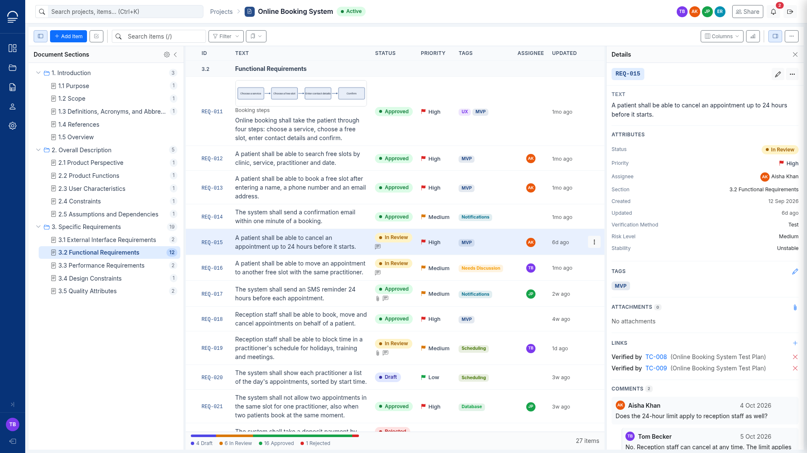
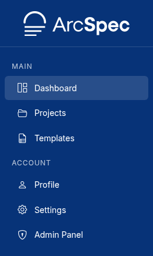
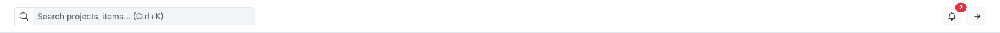

# 1. Getting started

## What ArcSpec does

ArcSpec is used to create and manage specifications, such as requirements, architecture descriptions and test documentation.

Each project is one document and is created from a template.
The template sets the project's numbered sections and the attributes of its items.
Each section contains items.
An item is a single entry, such as one requirement or one test case.
You can export a project to PDF or DOCX.

## Roles

Each account has a system role that applies across ArcSpec:

| System role | Can |
|---|---|
| Viewer | Open the projects they are a member of. |
| User | Do everything a Viewer can, and create projects and templates. |
| Administrator | Do everything a User can, work as Admin in every project, use the Admin Panel, and edit or delete any custom template. |

Inside each project, every member also has a project role:

| Project role | Can |
|---|---|
| Viewer | Read the project, export it and comment on items. |
| Editor | Do everything a Viewer can, and add, edit and delete sections, items, tags, attachments, links and attributes. |
| Admin | Do everything an Editor can, edit, archive and delete the project, manage collaborators and restore versions. |

## The screen

The sidebar on the left links to the main pages:

- **Dashboard**: your projects, recent activity and notifications
- **Projects**: the projects you are a member of
- **Templates**: the templates new projects are based on
- **Profile**: your account details and recent work
- **Settings**: email notifications, export defaults and password
- **Admin Panel**: users, templates, tag presets and system settings, for administrators only

The top bar contains:

- the search box, see [Search for projects and items](03-dashboard-notifications-search.md#search-for-projects-and-items)
- the notification bell, with the number of unread notifications
- the sign-out button
