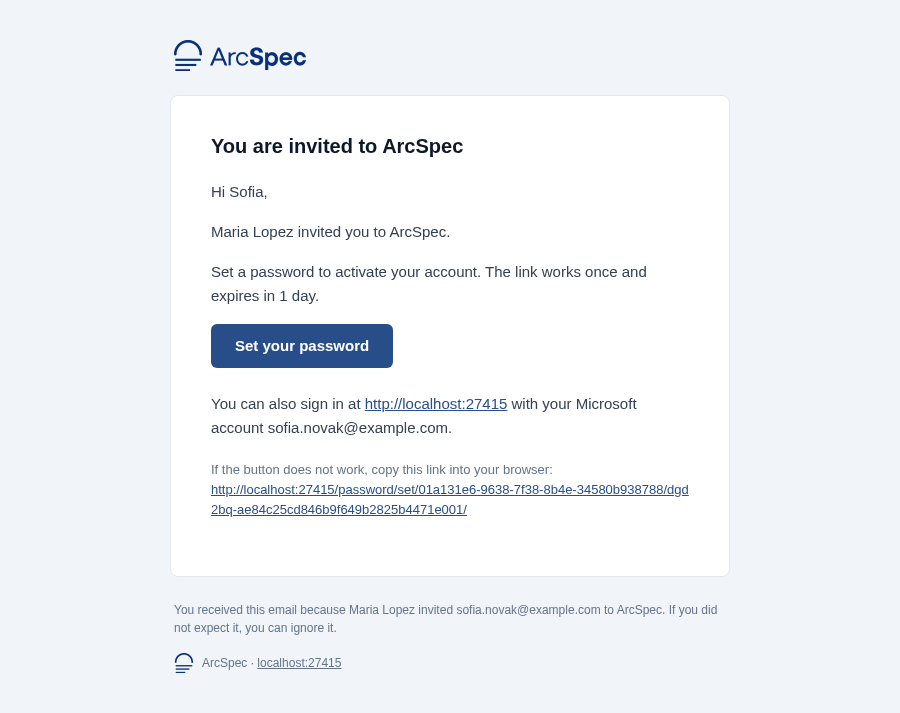
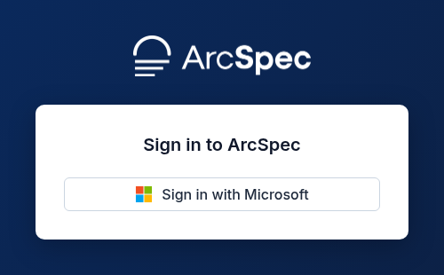
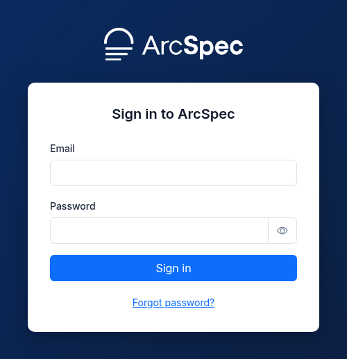
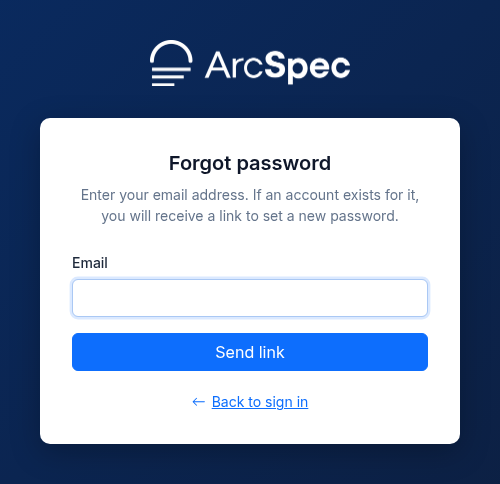
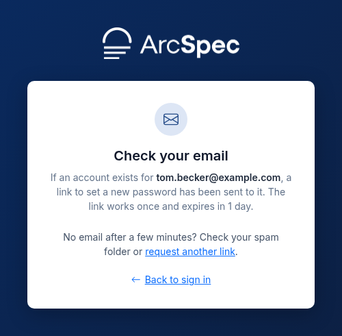
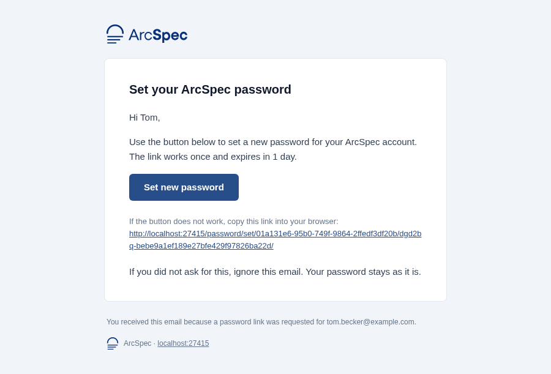
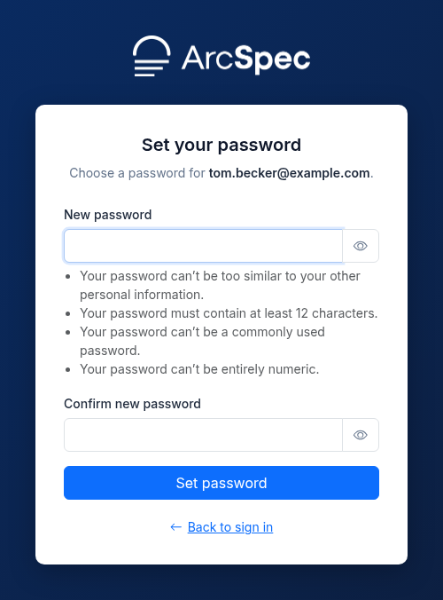
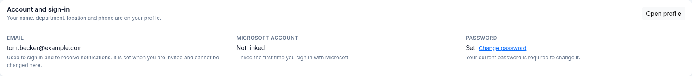
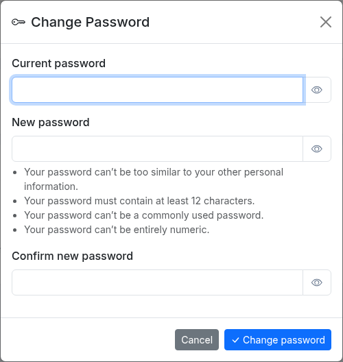
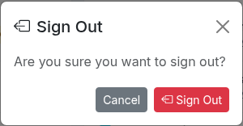

# 2. Signing in

You can sign in with a Microsoft account, with an email address and password, or both, depending on what is enabled.
Only accounts created by an administrator can sign in.

## Accept an invitation

When an administrator creates your account, you receive an invitation email.

1. Open the email and click **Set your password**.

2. Enter a password in **New password** and repeat it in **Confirm new password**.
3. Click **Set password**.

4. Sign in with your email address and the password.

The link works only once.
If it no longer works, ask your administrator to send the invitation again.
If the email has no **Set your password** button, sign in with Microsoft instead.

## Sign in with Microsoft

1. Open ArcSpec and click **Sign in with Microsoft**.

2. Sign in on the Microsoft page with your work account.

You return to the Dashboard.

## Sign in with email and password

1. Enter your email address and password.
2. Click **Sign in**.

Both sign-in methods can be enabled at the same time.

## Reset a forgotten password

1. On the sign-in page, click **Forgot password?**.
2. Enter your email address and click **Send link**.

A confirmation page opens and ArcSpec sends you an email with a link.

3. In the email, click **Set new password**.

4. Enter the new password twice and click **Set password**.

## Change your password

1. Click **Change password**, either on your profile next to **Sign-in**, or in **Settings** under **Account and sign-in**.

2. In the **Change Password** dialog, enter your current password, then the new password twice.
3. Click **Change password**.

You stay signed in and return to the page where you opened the dialog.
If you do not have a password yet, sign out and use **Forgot password?** on the sign-in page to set one.

## Sign out

1. Click the sign-out button, either at the bottom of the sidebar or at the right end of the top bar.
2. Click **Sign Out** to confirm.

