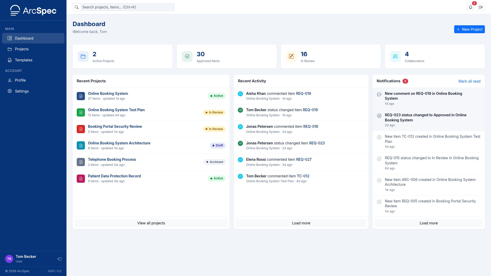
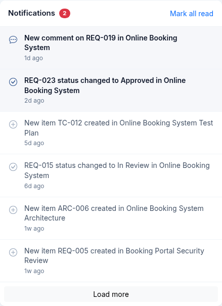
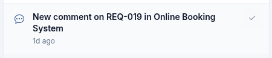
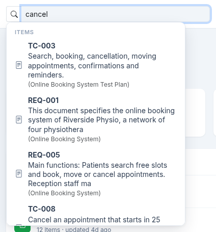

# 3. Dashboard, notifications and search

## The Dashboard

The Dashboard opens after you sign in.
To return to it, click **Dashboard** in the sidebar.

It contains:

- counts of your active projects, approved items, items in review and collaborators
- **Recent Projects**, with the most recently updated first; **View all projects** opens the Projects page
- **Recent Activity**, the latest changes in your projects; **Load more** shows older changes
- **Notifications**, described below
- the **New Project** button, see [Create a project](05-projects.md#create-a-project)

## Read and clear notifications

Notifications report changes in your projects.
They are listed in the **Notifications** panel on the Dashboard, and unread ones have a grey background.
The notification bell in the top bar also opens the Dashboard.

- Click a notification to open the page it refers to.
- To mark one notification as read, point to it and click the check mark.
- To mark all notifications as read, click **Mark all read**.

To receive notifications by email as well, see [Choose which emails you receive](04-profile-and-settings.md#choose-which-emails-you-receive).

## Search for projects and items

1. Type part of a project name, an item ID or some item text into the search box in the top bar.
2. Click a result.

A project result opens the project.
An item result opens its project with the item selected.

