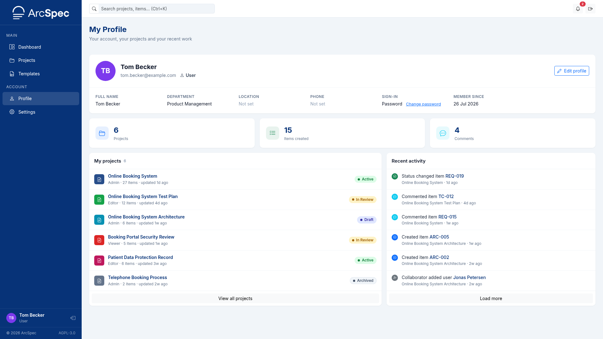
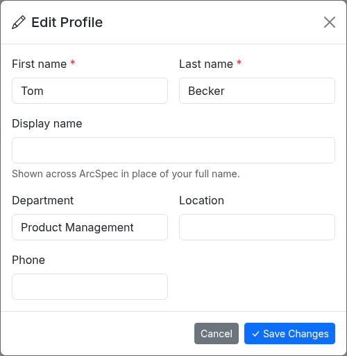
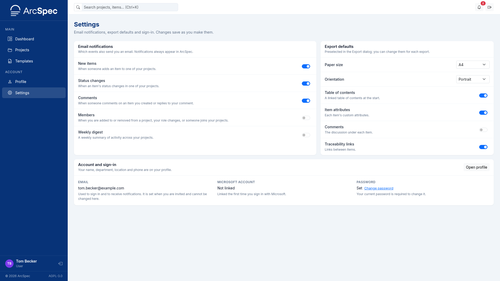
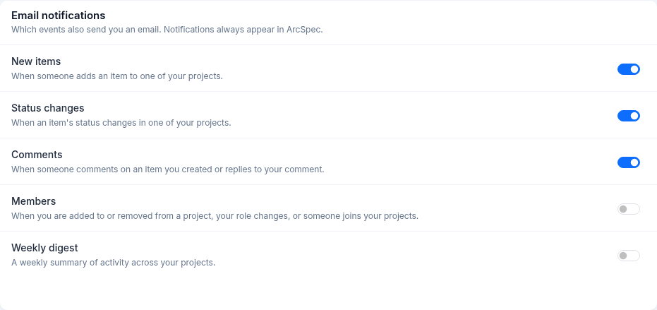
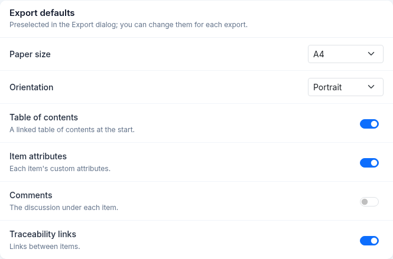

# 4. Profile and settings

## Edit your profile

1. Open **Profile** from the sidebar and click **Edit profile**.

2. Change the details you want. **First name** and **Last name** are required.
3. Click **Save Changes**.

If you fill in **Display name**, it is shown instead of your full name.
If you sign in with Microsoft, your name comes from your Microsoft account.
Your email address and system role cannot be changed here.

## Choose which emails you receive

1. Open **Settings** from the sidebar.

2. Under **Email notifications**, switch each type on or off: **New items**, **Status changes**, **Comments**, **Members** and **Weekly digest**.

Changes are saved immediately.
These switches control only email.
Every notification still appears on the Dashboard.

## Set your export defaults

1. Open **Settings** from the sidebar.
2. Under **Export defaults**, choose the **Paper size** and **Orientation**.
3. Switch **Table of contents**, **Item attributes**, **Comments** and **Traceability links** on or off.

Changes are saved immediately.
The Export dialog is pre-filled with these values, and you can change them for each export.

## See your connected apps

**Connected apps** in **Settings** shows the AI assistants that you connected to ArcSpec.
For each app, it shows the name, the domain and the access of the app.
It also shows the date when you connected the app and the date when the app last used ArcSpec.
To disconnect an app, refer to [Disconnect an app](10-connect-an-ai-assistant.md#disconnect-an-app).
