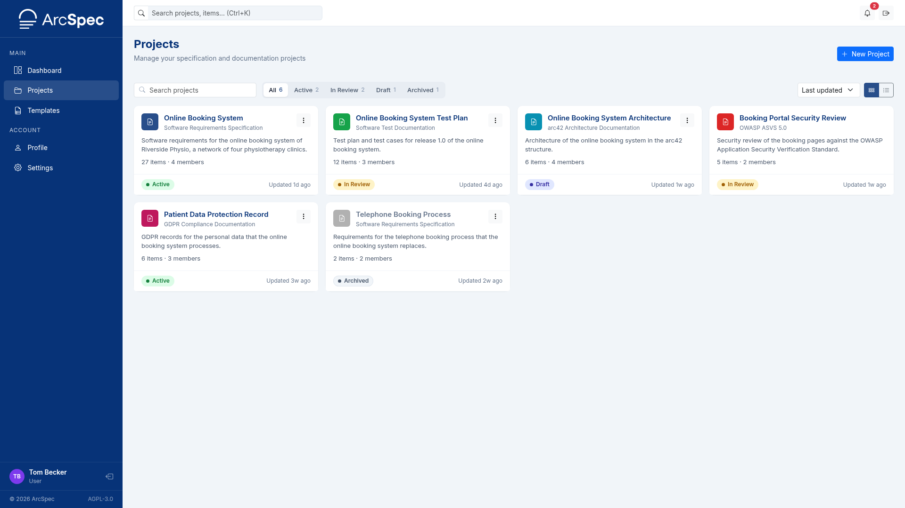
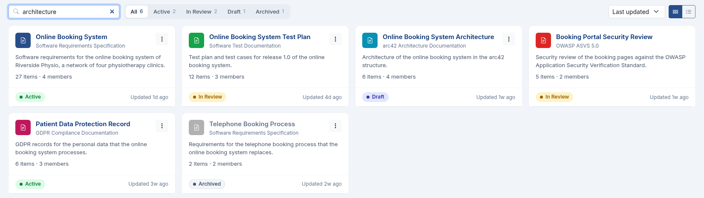
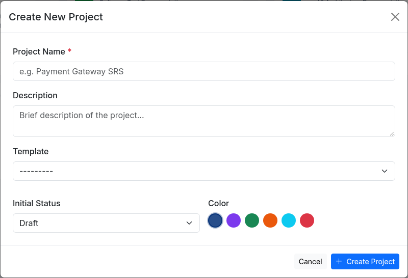
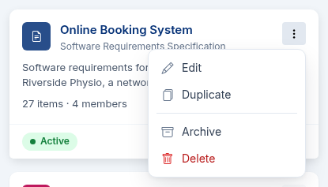
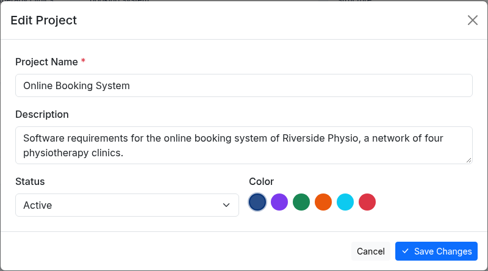
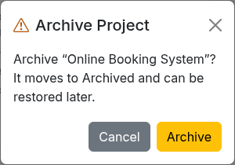
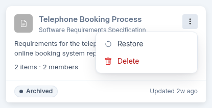
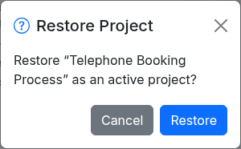
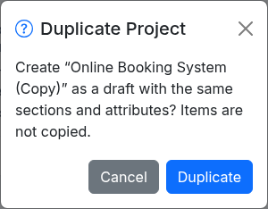
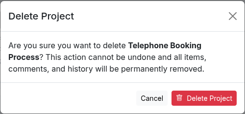

# 5. Projects

## Find a project

Open **Projects** from the sidebar.
The page lists the projects you are a member of.
Administrators see all projects.

- Type in **Search projects** to filter by name.
- Click **Active**, **In Review**, **Draft** or **Archived** to show projects with that status, or **All** to show every project.
- Use the sort list to order the projects by **Last updated**, **Name A-Z**, **Name Z-A** or **Date created**.
- Use the **Grid view** and **Table view** buttons on the right to switch between cards and a table.

Click a project name to open the project.

## Create a project

You need the User or Administrator system role.

1. Click **New Project** on the Projects page or the Dashboard.
2. Enter a **Project Name** and, optionally, a **Description**.
3. Choose a **Template**, an **Initial Status** and a **Color**.
4. Click **Create Project**.

The project gets the sections and attributes of the template, and you become its Admin.

## Edit a project

You need the Admin role in the project.

1. On the Projects page, click the three-dot button on the project and click **Edit**.

2. Change the name, description, status or color.
3. Click **Save Changes**.

An archived project has to be restored before it can be edited.

## Archive a project

You need the Admin role in the project.
An archived project is read-only until it is restored.

1. Click the three-dot button on the project and click **Archive**.
2. Click **Archive** in the dialog.

An administrator can also set projects to be archived automatically after a period without changes, and archived projects to be deleted after a further period.
See [Change system settings](09-administration.md#change-system-settings).

## Restore an archived project

Administrators can restore any archived project.
Project Admins can restore a project only if an administrator has allowed it.

1. On the Projects page, click **Archived**.
2. Click the three-dot button on the project and click **Restore**.

3. Click **Restore** in the dialog.

If **Restore** is greyed out, ask an administrator to restore the project.

## Duplicate a project

You need the Editor or Admin role in the project, and a system role other than Viewer.

1. Click the three-dot button on the project and click **Duplicate**.
2. Click **Duplicate** in the dialog.

The copy is a draft named after the original with "(Copy)" added.
It has the same sections and attributes, but no items.

## Delete a project

You need the Admin role in the project.

1. Click the three-dot button on the project and click **Delete**.
2. Click **Delete Project** to confirm.

The project is deleted together with its items, comments and history.
This cannot be undone.

