# 6. Working in a project

## 6.1 The project page

A project page has three columns: the sections tree on the left, the items table in the middle and the Details panel on the right.
Drag the border between two columns to change their width.

### Sections tree

The tree lists the sections and sub-sections with the number of items in each.

- Click a section to scroll the table to it.
- Click the arrow next to a section to show or hide its sub-sections.
- Click the gear next to **Document Sections** to open the Project Structure dialog, see [6.2 Sections and custom attributes](#62-sections-and-custom-attributes).
- Click the arrow at the top right of the tree to hide it. The first button in the toolbar shows it again.

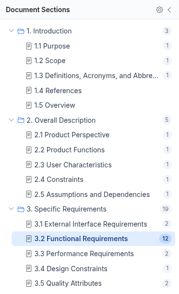

### Items table

Each row is one item, listed under its section heading.
The columns are **ID**, **Text**, **Status**, **Priority**, **Tags**, **Assignee** and **Updated**.
Small icons under the status mean the item has attachments or comments.
The bar at the bottom shows how many items have each status.

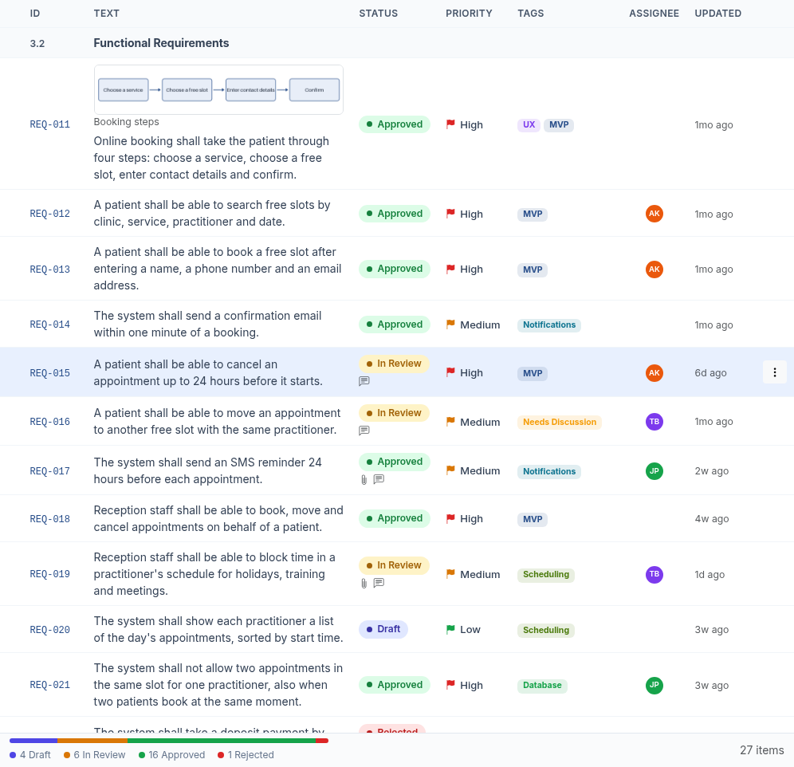

### Details panel

Click a row to open the item in the Details panel.
The panel shows the item's text, attributes, tags, attachments, links, comments and history.
Close it with the x at its top right.
To open it again, use the button next to the three-dot button at the right end of the toolbar.

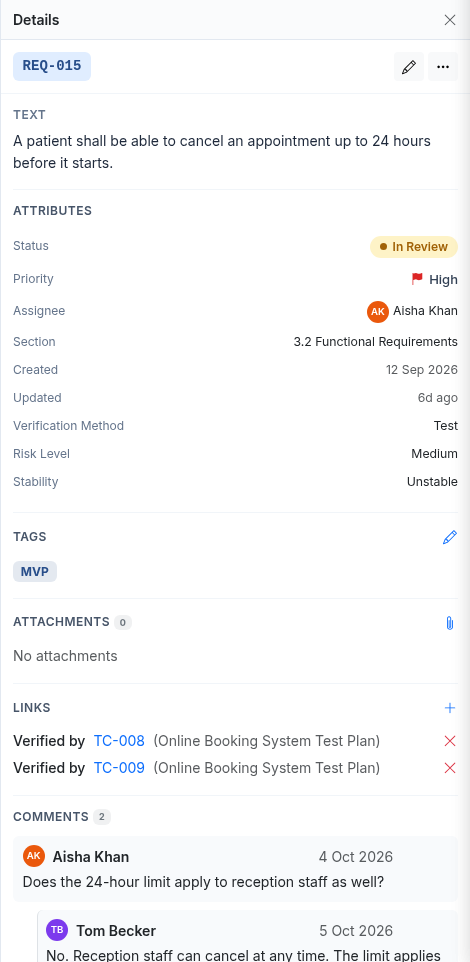

### Summary

To open the project summary, click the chart button to the right of **Columns**, in the toolbar above the table.

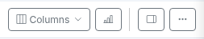

The summary shows the number of items, items by status and priority, items per section and the latest changes.

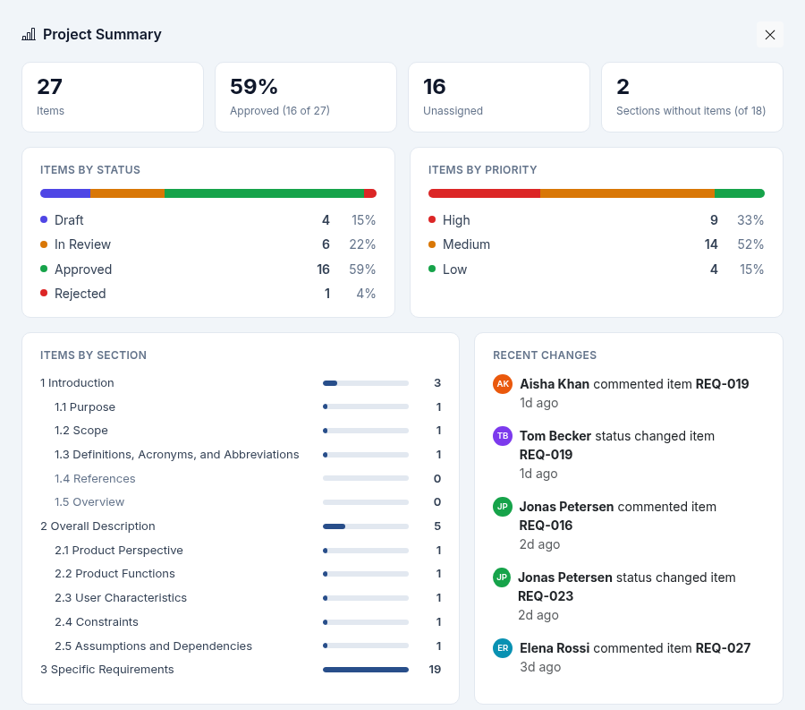

## 6.2 Sections and custom attributes

You need the Editor or Admin role in the project.
Changes in the Project Structure dialog are saved only when you click **Save Changes**.

### Add a section

1. Click the gear next to **Document Sections**.

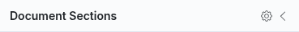

2. Click **Add Section**. The new section is added at the end of the list.
3. Enter a name and, optionally, a description in the box below it.
4. Click **Save Changes**.

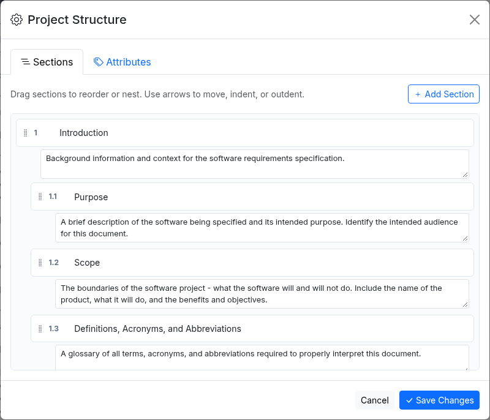

To add a sub-section, point to the parent section and click the plus button.

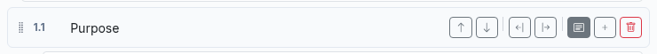

### Rename a section

1. Click the gear next to **Document Sections**.

2. Click the section name and type the new one.
3. Click **Save Changes**.

### Reorder and nest sections

1. Click the gear next to **Document Sections**.

2. Point to a section to show its buttons.
3. Use the up and down arrows to move the section.
4. Use the right arrow to make it a sub-section of the section above it, or the left arrow to move it up one level.
5. Click **Save Changes**.

You can also drag a section by the dots on its left.
The sections are renumbered automatically.

### Delete a section

1. Click the gear next to **Document Sections**.

2. Point to the section and click the bin.
3. Click **Save Changes**.

A section can be deleted only when it has no items.
Move or delete its items first.

### Add a custom attribute

A custom attribute is an extra field on every item in the project, for example Risk Level.
It appears in the item dialogs, in the Details panel and as a table column.

1. Click the gear next to **Document Sections** and open the **Attributes** tab.

2. Click **Add Attribute**.
3. Enter the attribute name and choose its type: **Text**, **Number**, **Date**, **Boolean**, **User**, **Dropdown** or **Multi-select**.
4. For **Dropdown** and **Multi-select**, enter the choices separated by commas.
5. Click **Save Changes**.

**Priority** and **Status** are built in and cannot be changed.

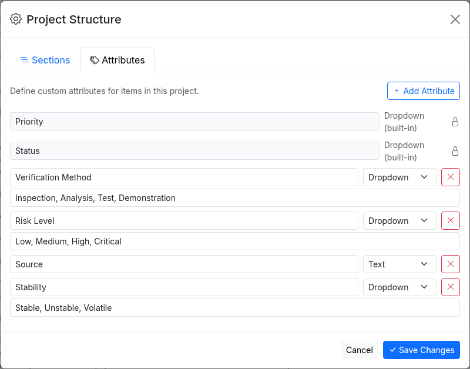

### Remove a custom attribute

1. Click the gear next to **Document Sections** and open the **Attributes** tab.

2. Click the x next to the attribute, then **Remove** to confirm.
3. Click **Save Changes**.

The values of that attribute are deleted from all items.

## 6.3 Items

You need the Editor or Admin role in the project to add or change items.
Project Viewers can read items and comment on them.

### Add an item

1. Click **Add Item** in the toolbar.
2. Choose the **Section** and enter the **Text**. The buttons above the text add bold, italic, underline, strikethrough, lists and tables.
3. Choose the **Status**, **Priority** and **Assignee**, and fill in any custom attributes.
4. Click **Add Item**.

The item gets the next free ID in the project, for example REQ-028.

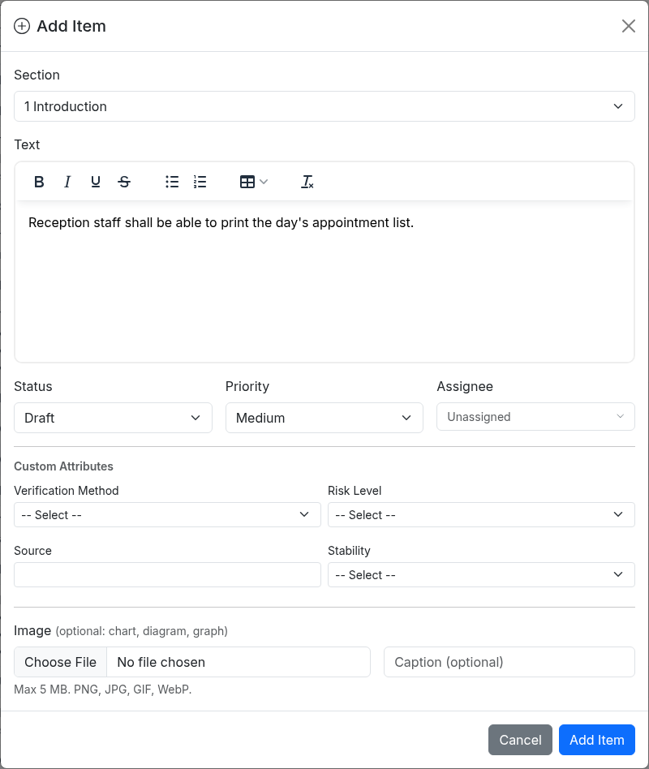

To add an item directly above or below another one, right-click that item and choose **Insert Above** or **Insert Below**.

### Edit an item

1. Select the item and click the pencil in the Details panel.
2. Change the fields.
3. Click **Save Changes**.

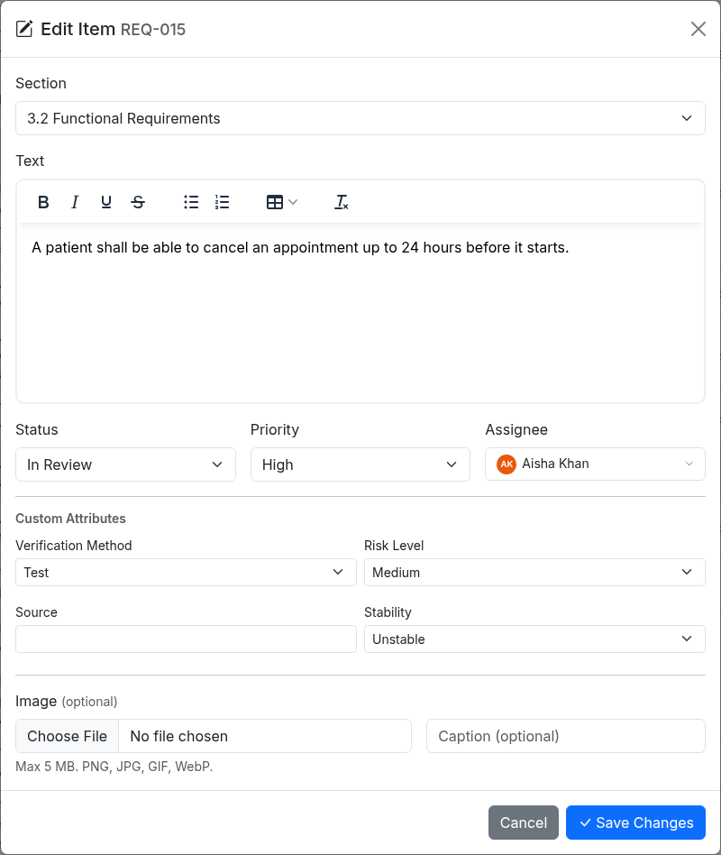

### Set status, priority, tags and assignee

1. Right-click the item, or point to it and click the three-dot button at the end of the row.
2. Point to **Set Status**, **Set Priority** or **Set Tags** and click a value.

The change is saved immediately.
The assignee is changed in the Edit Item dialog, see [Edit an item](#edit-an-item).

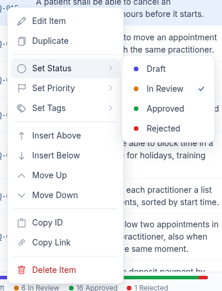

### Add an image

1. Select the item and click the pencil in the Details panel.
2. Under **Image**, click **Choose File** and pick an image.
3. Add a **Caption** if you want one.
4. Click **Save Changes**.

ArcSpec checks the MIME type of the image.

The image is shown above the item text in the table and in the Details panel.
In the Details panel, click the image to view it full size, **Change** to replace it or **Remove** to delete it.

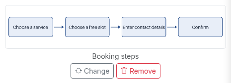

### Move an item to another section

1. Select the item and click the pencil in the Details panel.
2. Choose a different **Section**.
3. Click **Save Changes**.

You can also drag the row by the dots on its left into another section.

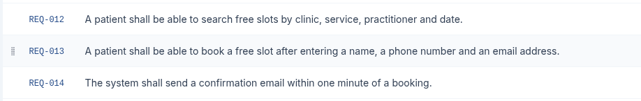

### Reorder items

Right-click the item and choose **Move Up** or **Move Down**.
You can also drag the row by the dots on its left to a new position.

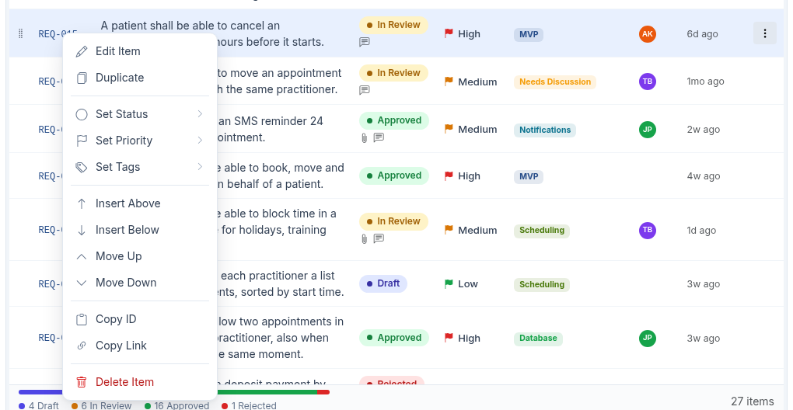

### Duplicate an item

1. Right-click the item and choose **Duplicate**.
2. Click **Duplicate** in the dialog.

The copy gets a new ID.

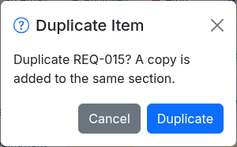

### Delete an item

1. Right-click the item and choose **Delete Item**.
2. Click **Delete** to confirm.

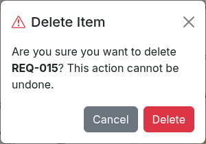

A project Admin can get a deleted item back by restoring an earlier version, see [Restore a version](07-working-with-others.md#restore-a-version).

### Copy a link to an item

Right-click the item and choose **Copy Link**, then paste the link where you need it.
The link opens the project with the item selected.
**Copy ID** copies only the item ID.

## 6.4 Find items

### Search items

Type in **Search items** in the toolbar.
The table then shows only items whose ID or text contains what you typed, and the count at the bottom right shows how many match.
Clear the box to show all items again.

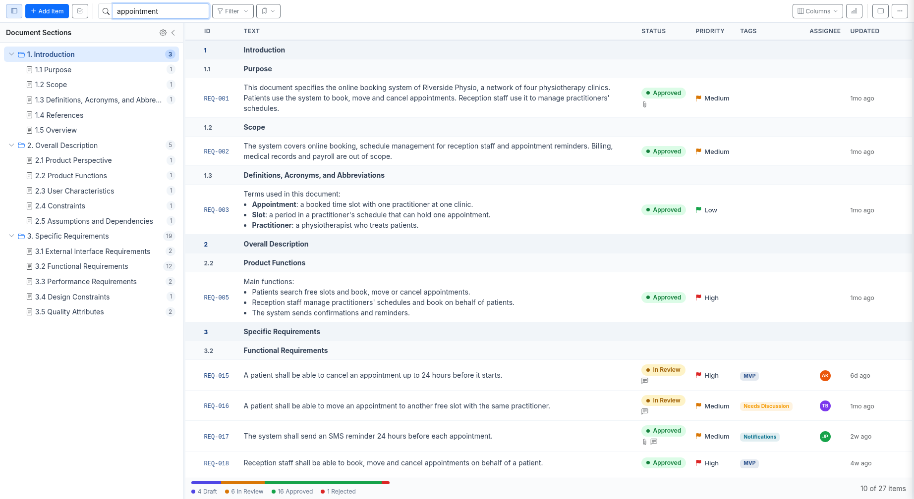

### Filter items

1. Click **Filter**.
2. Choose a **Status**, **Priority** or **Tag**.
3. Click **Apply**.

To remove the filter, open **Filter** again and click **Clear**.

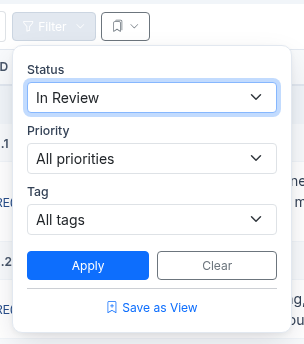

### Save a view

A saved view stores a filter under a name.
Only you can see your saved views.

1. Click **Filter** and set the filter.
2. Click **Save as View**.
3. Enter a **View Name** and click **Save**.

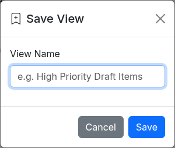

To use a saved view, click the bookmark button next to **Filter** and pick the view.
To delete one, open the same menu, point to **Delete a view**, click the view and confirm with **Delete**.

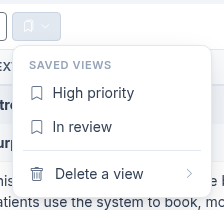

### Choose columns

Click **Columns** and click a column name to show or hide it.
You can choose **Tags**, **Assignee** and each custom attribute.
Your choice is kept for this project.

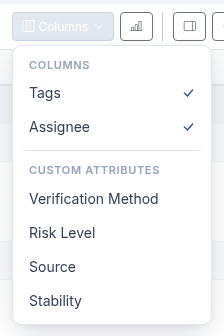

## 6.5 Change many items at once

You need the Editor or Admin role in the project.

1. Click the button next to **Add Item** to turn on selection. A tick box appears on each row.
2. Tick the items you want, or use the tick box in the bar above the table to select all.
3. Use **Status**, **Priority** or **Tag** to change the selected items. **Tag** adds a tag to them.
4. To delete the selected items, click **Delete** and confirm.
5. Click the button next to **Add Item** again to turn selection off.

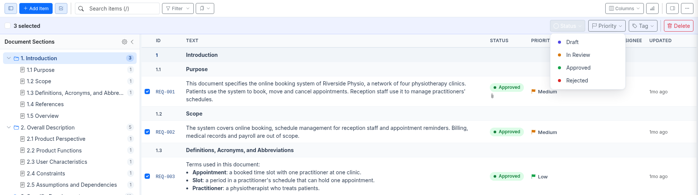
