# 7. Working with others

## Invite a collaborator

You need the Admin role in the project.
The person must already have an ArcSpec account, which an administrator creates, see [Invite a user](09-administration.md#invite-a-user).

1. In the project, click **Share** in the top bar.
2. Enter the person's email address.
3. Choose **Viewer**, **Editor** or **Admin**, see [Roles](01-getting-started.md#roles).
4. Click **Invite**.

The project then appears in the person's project list.

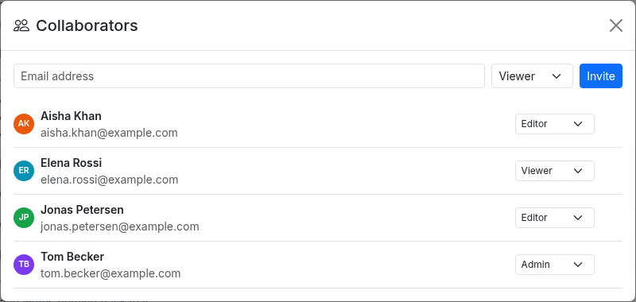

## Change a collaborator's role

You need the Admin role in the project.

1. Click **Share**.
2. Choose the new role in the person's row.
3. Click **Change** to confirm.

Every project must keep at least one Admin.

## Remove a collaborator

You need the Admin role in the project.

1. Click **Share**.
2. Point to the person's row and click the x.
3. Click **Remove** to confirm.

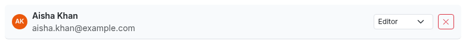

## Comment on an item

Every project member can comment, including Viewers.

1. Select the item.
2. In the Details panel, type your comment in the box under **Comments**.
3. Click the paper plane button.

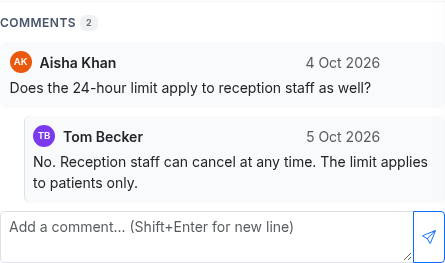

To reply, point to a comment, click the curved arrow, type your reply and send it.

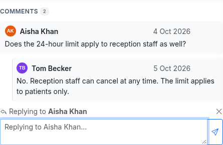

To delete a comment, point to it, click the bin and confirm with **Delete**.
You can delete your own comments, and project Admins can delete any comment.

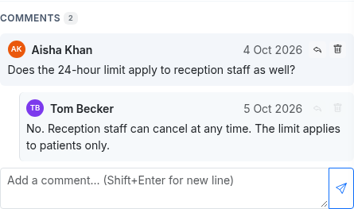

Comments in an archived project can be read but not added, answered or deleted.

## Link items

A link connects two items, for example a requirement and the test case that verifies it.
The link types are **Traces to**, **Derived from**, **Verified by**, **Conflicts with** and **Related to**.
You need the Editor or Admin role in the project.

1. Select the item.
2. In the Details panel, click the plus next to **Links**.
3. Choose the **Link Type**.
4. Under **Target Item**, type an item ID or some text and pick the item from the results.
5. Click **Add Link**.

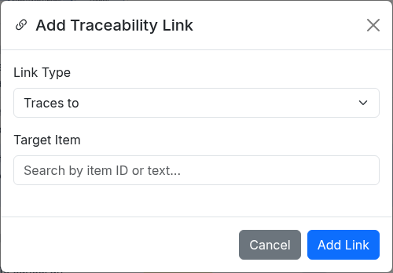

The **Links** section lists the item's links.
Links that point to this item from another item start with **From**.
To remove a link, click the x at the end of its line.

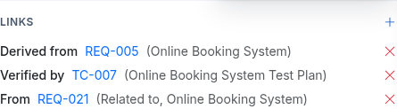

## Attach a file

You need the Editor or Admin role in the project.

1. Select the item.
2. In the Details panel, click the paper clip next to **Attachments**.
3. Choose the file.

ArcSpec checks the MIME type of the file.

Click a file name to download the file.
Click the x at the end of its line to delete it.

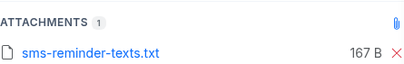

## Manage tags

A tag is a coloured label on an item.
The available tags are the tag presets set up by an administrator, see [Manage tag presets](09-administration.md#manage-tag-presets).
You need the Editor or Admin role in the project.

1. Select the item.
2. In the Details panel, click the pencil next to **Tags**.
3. Click a tag to add it or remove it.

You can also use **Set Tags** in the item's right-click menu, or tag many items at once, see [Change many items at once](06-working-in-a-project.md#65-change-many-items-at-once).

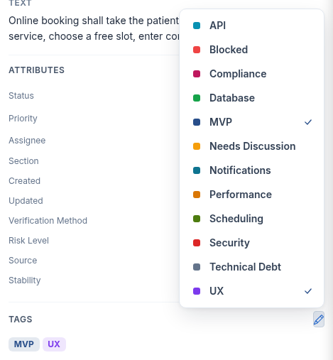

## View version history

A new version of the project is saved when an item is created, deleted or changes status, when many items are changed at once, and when an older version is restored.

1. Click the three-dot button at the right end of the toolbar.
2. Click **Version History**.

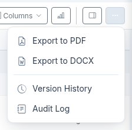

Each entry shows the version number, who made the change, when, and what changed.

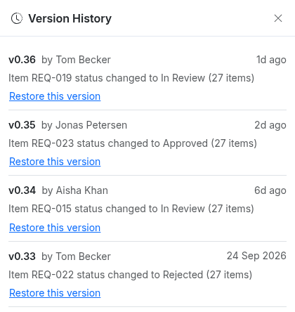

## Restore a version

You need the Admin role in the project.
Restoring replaces all current items with the items from that version.

1. Click the three-dot button at the right end of the toolbar and click **Version History**.
2. Click **Restore this version** under the version you want.
3. Click **Restore** to confirm.

The restored state is saved as a new version.

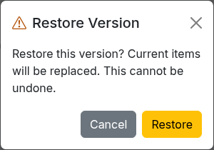

## Read the audit log

The audit log lists every change in the project, with who made it and when.

1. Click the three-dot button at the right end of the toolbar.
2. Click **Audit Log**.
3. To narrow the list, choose an action under **All actions** or a person under **All users**.

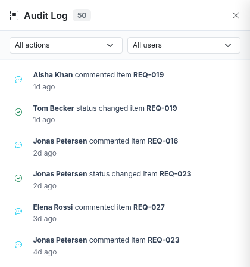

## Export to PDF or DOCX

Every project member can export a project.

1. Click the three-dot button at the right end of the toolbar.
2. Click **Export to PDF** or **Export to DOCX**.
3. Choose the **Format**, **Paper Size** and **Orientation**.
4. Under **Include**, tick what the document should contain: **Table of Contents**, **Authors**, **Assignee**, **Custom Attributes**, **Comments** and **Traceability Links**.
5. Click **Export**. The file is downloaded.

The dialog is pre-filled with your export defaults, see [Set your export defaults](04-profile-and-settings.md#set-your-export-defaults).

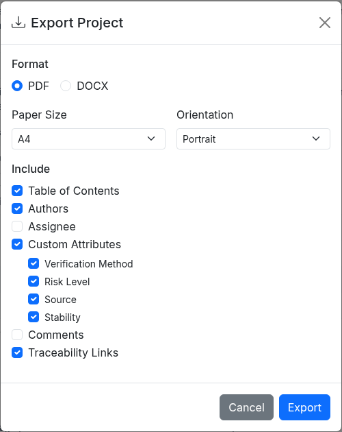
