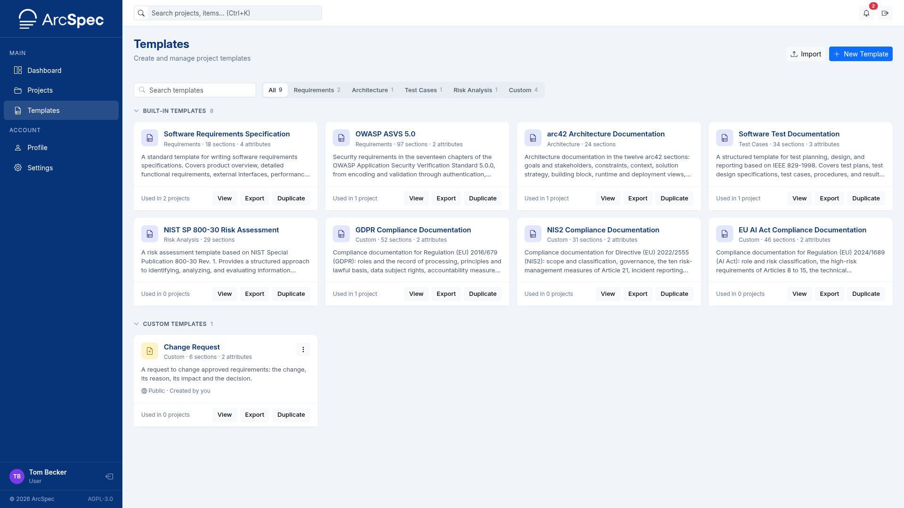
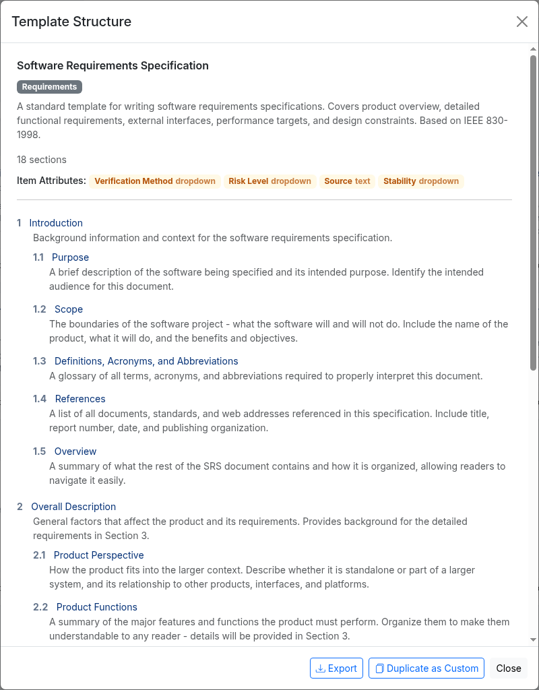
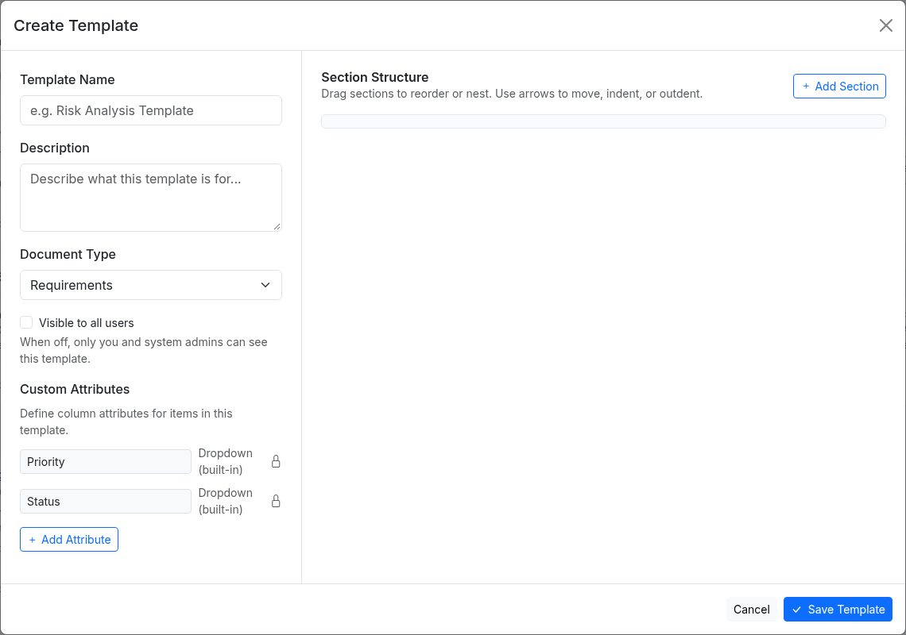
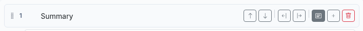
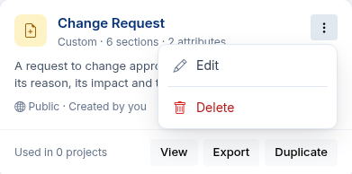
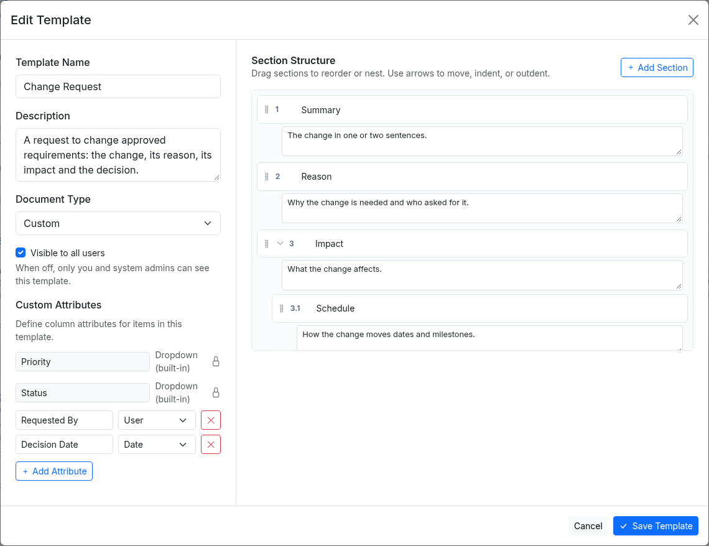
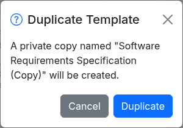
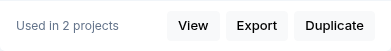
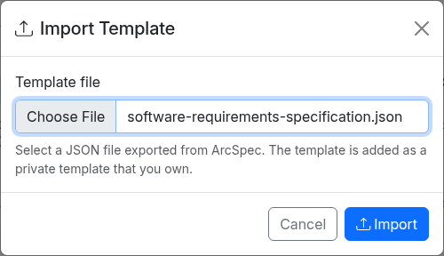
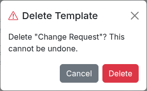

# 8. Templates

A template defines the sections and item attributes of new projects.
The built-in templates cannot be changed.
Users and Administrators can create their own custom templates.
Changing a template does not affect projects that were already created from it.

## Browse templates

1. Open **Templates** from the sidebar.
2. Type in **Search templates** to filter by name.
3. Click **Requirements**, **Architecture**, **Test Cases**, **Risk Analysis** or **Custom** to show one document type, or **All** to show every template.

Built-in templates are listed first and custom templates after them.
Each card shows the document type, the number of sections and attributes, and how many projects use the template.

## View a template

On the Templates page, click the template name or **View**.
The **Template Structure** dialog shows the sections with their descriptions, and the item attributes.

## Create a template

You need the User or Administrator system role.

1. Click **New Template**.
2. Enter a **Template Name** and a **Description**.
3. Choose the **Document Type**. It sets the prefix of item IDs: REQ for Requirements, ARC for Architecture, TC for Test Cases, RSK for Risk Analysis and ITEM for Custom.
4. Tick **Visible to all users** if everyone should be able to use the template. Otherwise only you and the administrators can see it.
5. Under **Custom Attributes**, click **Add Attribute** for each attribute, then enter its name and choose its type.
6. Under **Section Structure**, click **Add Section** for each section, then enter its name and description.
7. Click **Save Template**.

Point to a section to show its buttons.
They move the section up or down, change its level, show or hide its description, add a sub-section and delete the section.
You can also drag a section by the dots on its left.

## Edit a template

The creator of a custom template and the administrators can edit it.

1. Click the three-dot button on the template card and click **Edit**.

2. Change the details, attributes or sections.
3. Click **Save Template**.

## Duplicate a template

You need the User or Administrator system role.
Built-in templates can be duplicated too.

1. Click **Duplicate** on the template card.
2. Click **Duplicate** in the dialog.

This creates a private copy of the template that you can edit.

You can also duplicate a template from the **Template Structure** dialog with **Duplicate as Custom**.

## Export a template

You can export each template that you can see.
This includes the built-in templates.

1. Click **Export** on the template card.

You can also click **Export** in the **Template Structure** dialog.

The browser downloads the template as a JSON file.
You can import the file into a different ArcSpec installation.

## Import a template

Your system role must be User or Administrator.

1. Click **Import** on the Templates page.
2. In the **Import Template** dialog, select a JSON file that you exported from ArcSpec.
3. Click **Import**.

ArcSpec adds the template as your private template.
To let all users use the template, edit it and select **Visible to all users**.

The file must not be larger than 1 MB.

## Delete a template

The creator of a custom template and the administrators can delete it.

1. Click the three-dot button on the template card and click **Delete**.
2. Click **Delete** in the dialog.

A template that is used by a project cannot be deleted.
In that case **Delete** is greyed out and the menu shows how many projects use it.
