# 9. Administration

Open **Admin Panel** from the sidebar.
It has four tabs: **Users**, **Templates**, **Tag Presets** and **System Settings**.

## Invite a user

1. On the **Users** tab, click **Invite User**.
2. Enter the person's **Email**, **First name** and **Last name**.
3. Click **Invite**.

The account is created with the User role, and the person receives an invitation email.
To give them another role, see [Change a user's role](#change-a-users-role).

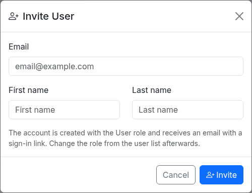

The **Users** tab lists every account with its role, number of projects, last sign-in and status.
Use **Search users**, or click **Administrator**, **User** or **Viewer**, to find an account.
The list shows 25 accounts per page. 

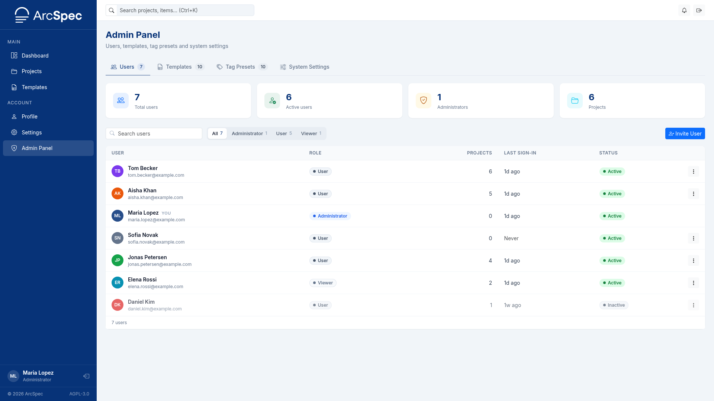

## Change a user's role

1. Click the three-dot button at the end of the user's row and click **Edit Role**.

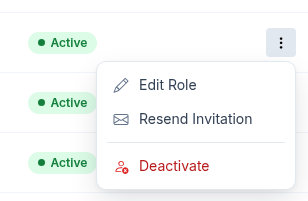

2. Choose **Viewer**, **User** or **Administrator**.
3. Click **Save**.

You cannot change your own role.

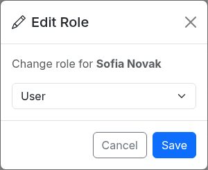

## Resend an invitation

**Resend Invitation** is available only for accounts that have never signed in and have no password.

1. Click the three-dot button at the end of the user's row and click **Resend Invitation**.
2. Click **Send** to confirm.

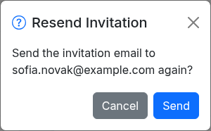

## Deactivate a user

1. Click the three-dot button at the end of the user's row and click **Deactivate**.
2. Click **Deactivate** in the dialog.

The person can no longer sign in.
If they are signed in, the next page they open is the sign-in page.
Their projects and memberships are kept.
You cannot deactivate your own account.

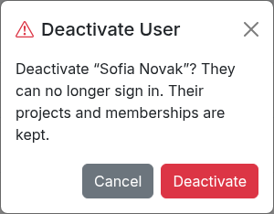

## Reactivate a user

1. Click the three-dot button at the end of the user's row and click **Reactivate**.
2. Click **Reactivate** in the dialog.

The person can sign in again.

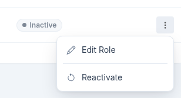

## Set template visibility

A public custom template can be seen by every user.
A private one can be seen only by its creator and the administrators.

1. Open the **Templates** tab.
2. Click the eye button at the end of the template's row.
3. Click **Make public** or **Make private** to confirm.

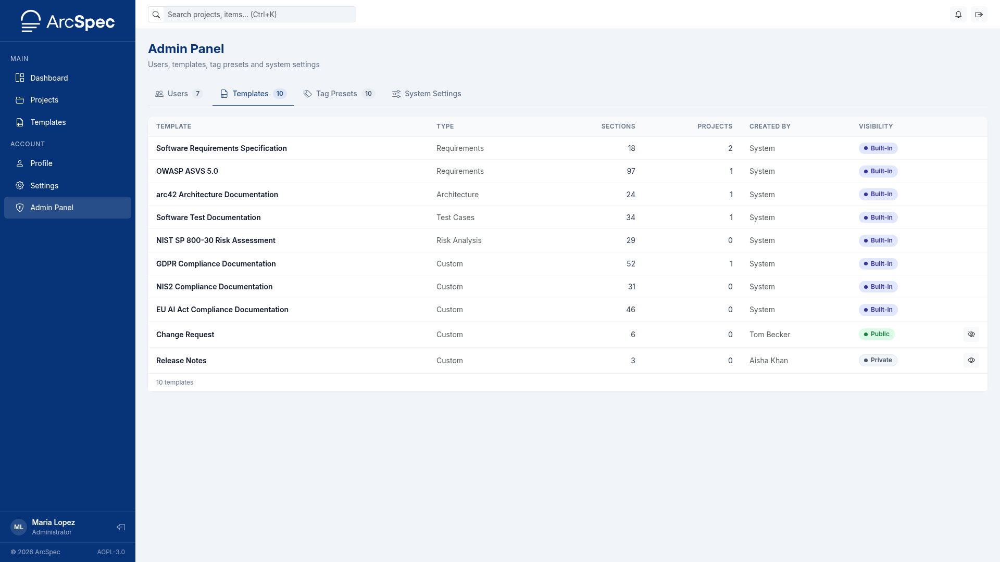

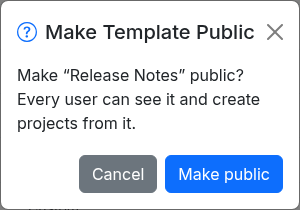

## Manage tag presets

Tag presets are the tags available in every project.

1. Open the **Tag Presets** tab and click **Add Preset**.
2. Enter a **Name** and choose a **Color**.
3. Click **Create**.

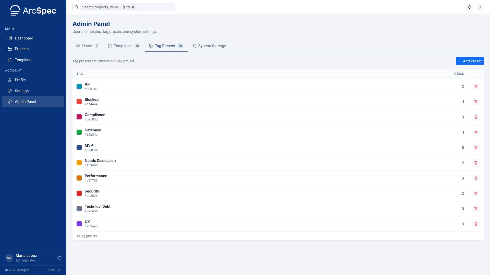

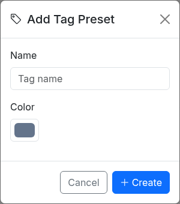

To delete a preset, click **Delete** in its row and confirm.
The tag is removed from every item that has it.

## Change system settings

1. Open the **System Settings** tab.
2. Change the settings in one section.
3. Click **Save** in that section.

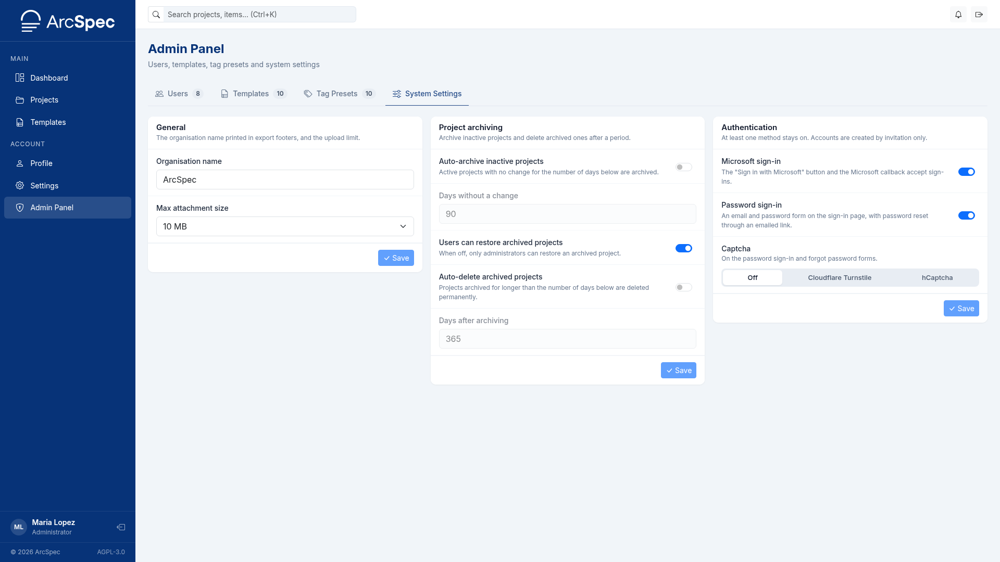

**General**

- **Organisation name** is printed in the footer of exported documents.
- **Max attachment size** is the largest file that can be attached to an item.

**Project archiving**

- **Auto-archive inactive projects** archives active projects that have not changed for the number of days in **Days without a change**.
- **Users can restore archived projects** lets project Admins restore archived projects. When it is off, only administrators can.
- **Auto-delete archived projects** deletes projects that have been archived for longer than the number of days in **Days after archiving**. Deleted projects cannot be recovered.

**Authentication**

- **Microsoft sign-in** shows **Sign in with Microsoft** on the sign-in page.
- **Password sign-in** shows the email and password form, with **Forgot password?**, on the sign-in page.
- **Captcha** adds a verification step to the password sign-in form and the forgot password form. It is shown only while **Password sign-in** is on. Choose **Off**, **Cloudflare Turnstile** or **hCaptcha**. A provider without keys on the server is greyed out and cannot be selected.

At least one sign-in method must stay on.
