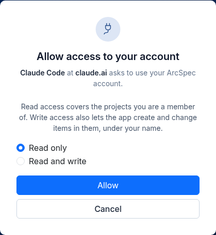
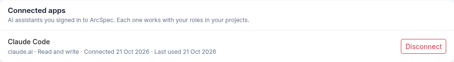
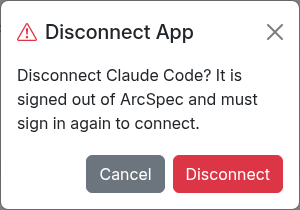

# 10. Connect an AI assistant

An AI assistant can read your projects and change items for you.
The assistant connects to the Model Context Protocol (MCP) server of ArcSpec.
In this chapter, an AI assistant that connects to ArcSpec is an app.

## Before you start

An administrator must start the MCP server.
Refer to [Start the MCP server](09-administration.md#start-the-mcp-server).
While the MCP server is off, ArcSpec stops all requests from apps.

The address of the MCP server is the ArcSpec address with `/mcp` at the end.
For example: `https://arcspec.example.com/mcp`.

## Connect Claude Code

1. In your project folder, add the MCP server to the `.mcp.json` file:

   ```json
   {
     "mcpServers": {
       "arcspec": {
         "type": "http",
         "url": "https://arcspec.example.com/mcp"
       }
     }
   }
   ```

2. Start Claude Code in that folder.
3. Type `/mcp`, select **arcspec** and then select **Authenticate**.

   Your browser opens ArcSpec.

4. If you are not signed in, sign in.
   Refer to [Signing in](02-signing-in.md).
5. On the **Allow Access** page, make sure that the name and the domain of the app are correct.
6. Select **Read only** or **Read and write**.
7. Click **Allow**.



The app is connected.
You can close the browser tab.

To connect a different app, add a remote MCP server in that app.
Type the address of the MCP server.
Then, do steps 4 thru 7.

## Read only or Read and write

On the **Allow Access** page, you select the access of the app:

- **Read only**: The app can read the projects that you are a member of. The app cannot change data.
- **Read and write**: The app can also add and change items.

The app has the same permissions as you.
To change data in a project, your role in that project must be Editor or Admin.
The app cannot change data in an archived project.

When the app changes data, ArcSpec records your name in the **Audit Log** and in the **Version History**.
The other members of the project get the usual notifications.
For changes from an app, ArcSpec sends each person a maximum of 3 emails in 15 minutes for one project.
All notifications show on the Dashboard.

If the app has **Read only** access and tries to change data, Claude Code shows a message.
The message tells you that the app must have the "write" permission.
To give the app **Read and write** access, do these steps:

1. Type `/mcp`, select **arcspec** and then select **Clear authentication**.
2. Select **arcspec** again and then select **Authenticate**.
3. On the **Allow Access** page, select **Read and write** and click **Allow**.

## Functions of an app

With **Read only** access, an app can:

- Find your projects, and read the template and the members of a project.
- Read the sections, items, tags, attributes, comments and links of a project.
- Read the **Version History** and the **Audit Log** of a project.
- Read the templates.
- Find projects and items with a text search.

With **Read and write** access, an app can also:

- Add items. The app can add one item or a maximum of 100 items in one request.
- Change the text, the section, the position, the status, the priority, the assignee and the attribute values of an item.
- Add tags to an item and remove tags from an item.
- Add comments and replies.
- Add links between items. The other item can be in a different project that you are a member of.

An app cannot delete data.
An app cannot change projects, sections, members, templates, attachments or images.
An app cannot use the Admin Panel.

The app writes the text of an item in Markdown.
ArcSpec keeps paragraphs, bold text, italic text, strikethrough text, lists and tables.
Headings, code, links and images stay as the characters that the app wrote.
An app cannot underline text.
Comments from an app are plain text, as on the project page.

## How long a connection stays

Each hour, the app gets new access from ArcSpec.
This is automatic.
30 days after you sign in from the app, the connection stops.
To connect the app again, sign in again from the app.

If an administrator deactivates your account, your apps cannot use ArcSpec.

When ArcSpec gets new functions for apps, Claude Code does not show them immediately.
To get the new functions, type `/mcp`, select **arcspec** and then select **Reconnect**.

## Disconnect an app

1. Open **Settings** from the sidebar.
2. In **Connected apps**, find the app.
3. Click **Disconnect**.
4. Click **Disconnect** in the dialog.





The app cannot use ArcSpec after this.
To connect the app again, sign in again from the app.

**Connected apps** shows each app with its name, its domain and its access.
It also shows the date when you connected the app and the date when the app last used ArcSpec.
While the MCP server is off, **Connected apps** shows a note.
You can disconnect your apps at all times.

## Apps that cannot connect

These apps cannot connect to ArcSpec:

- An app that can use only dynamic client registration.
- An app that uses a callback address with a scheme other than `http` or `https`.
- An app that operates in a web page in a browser.
